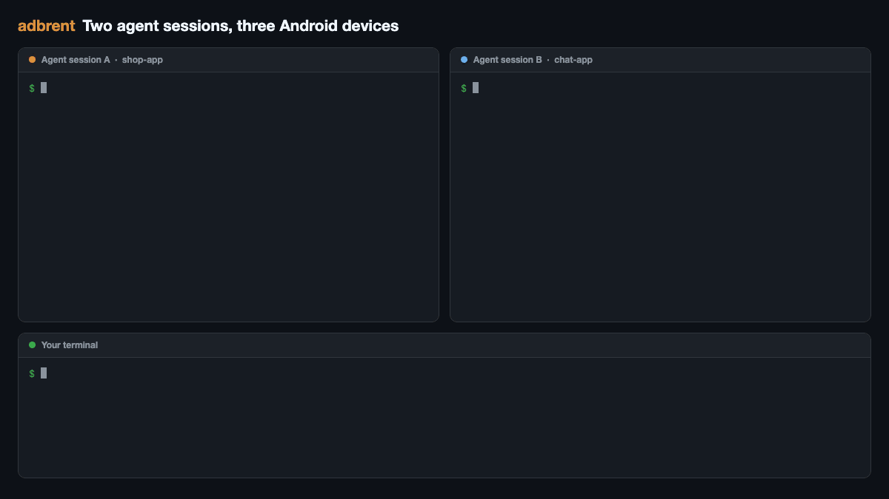
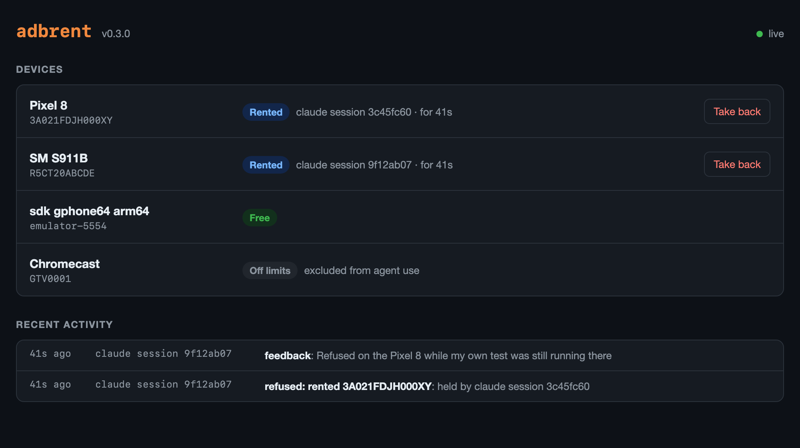

# adbrent: one Android device per AI agent

[](https://github.com/iammosab/adbrent/releases)
[](https://crates.io/crates/adbrent)
[](LICENSE)

[](#in-claude-code)

**Stop parallel AI coding agents from fighting over the same Android phone or emulator.**
adbrent is a device lock for `adb`: each Claude Code, Codex, Gemini CLI or other agent
session automatically gets its own Android device, and keeps it until the session ends.

When several agent sessions run on one machine, they all see the same `adb devices` list
and end up driving the same phone: one installs an APK while another is halfway through a
UI test. adbrent gives each session its own device. The first `adb` command a session
runs rents a free device, later commands go to that same device, and any other session
that targets it is refused with a message naming the devices that are free. Agents never
hit `adb: more than one device/emulator`, and never need to be told which serial to use.



```console
$ adb shell getprop ro.product.model
adbrent: rented 3A021FDJH000XY (Pixel 8) to this session. Run `adbrent release` when you no longer need it.
Pixel 8

$ adb -s R5CT20ABCDE install app.apk
adbrent: R5CT20ABCDE (SM S911B) is already rented by another agent (claude session 3c45fc60 in shop-app, for 4m). Do not use it.
adbrent: free now: emulator-5554 (sdk gphone64 arm64). Use plain `adb` or `adb -s <serial>` to rent one.
```

- **Nothing for agents to learn.** They keep typing `adb`.
- **No daemon.** One 0.5 MB binary; a rental is one small file. A command on a device the
  session already holds adds under a millisecond.
- **Self-healing.** A session that closes or crashes loses its rental immediately.
- **Sees use it does not manage.** Before handing out a device, adbrent asks the device
  whether anything is running on it over adb. A phone that Gradle, Android Studio, scrcpy
  or a plain `adb` elsewhere is using is left alone.

## Install

You need macOS or Linux, and `adb` on your PATH (Android SDK platform-tools).

### In Claude Code

Inside a Claude Code session, run:

```
/plugin marketplace add iammosab/adbrent
/plugin install adbrent@adbrent
```

Then restart your sessions. The first session to start fetches the adbrent program into
`~/.adbrent`:

- On a Mac (Apple Silicon or Intel) it downloads the prebuilt binary from this
  repository's GitHub release and checks it against the SHA-256 recorded in the plugin.
- Anywhere else it builds it with `cargo`, which takes about half a minute and needs a
  recent stable [Rust](https://rustup.rs).

If neither works, the session is told that adbrent is not active.

The same two steps from a terminal:

```sh
claude plugin marketplace add iammosab/adbrent
claude plugin install adbrent@adbrent
```

### With cargo

```sh
cargo install adbrent
adbrent install
```

The first command builds the binary into `~/.cargo/bin`. The second copies it to
`~/.adbrent`, creates the `adb` stand-in, and installs the same Claude Code plugin for
you. Use this route for other agents too; `adbrent install --shim-only` skips the plugin.

### Check that it works

Start a new Claude Code session and ask it to run `adb shell getprop ro.product.model`.
It should report that a device was rented to the session. In a terminal,

```sh
~/.adbrent/bin/adbrent status
```

should then show that session as the renter, and show the device free again once the
session ends. Sessions that were open before the install keep using plain adb until they
are restarted.

### Other agents and harnesses

Put the stand-in first on the PATH that the agent runs commands with, for example in the
shell profile or launch script the agent uses:

```sh
eval "$(~/.adbrent/bin/adbrent env)"
```

The renter is the agent process the command runs under. Codex, opencode, Gemini CLI and
several others are recognised by name; anything else falls back to the nearest parent
process that is not a shell. Set `ADBRENT_SESSION=<id>` in a session's environment when the harness runs several
sessions inside one process, or when its agents start adb in detached background jobs:
a job cut loose from the agent's process can only be matched to its session by that id.
(Claude Code sessions carry such an id already.)

### Update

In Claude Code, `/plugin marketplace update adbrent`, then restart your sessions: the
next one fetches the matching program. With cargo, repeat the two install commands with
`--force` on the first.

### Uninstall

```sh
~/.adbrent/bin/adbrent uninstall
```

removes the Claude Code plugin and `~/.adbrent`, rentals included. If you installed with
cargo, also run `cargo uninstall adbrent`.

## What agents see

| Command | Behaviour |
|---|---|
| `adb <cmd>` with no device named | Goes to the session's device, renting a free one first if it has none |
| `adb -s <serial> <cmd>` | Rents that device if free; refused if another session holds it |
| `adb devices` | Lists the session's own devices and the free ones |
| `adb kill-server` | Refused while another session holds a device |

`-t <id>`, `-d`, `-e` and `ANDROID_SERIAL` are understood the same way. Commands that
address no device (`adb version`, `adb connect`, `adb forward --list`) pass straight
through.

Plain `adb` hands out a free device that nobody is using, phones and tablets first: a TV,
a watch or a car unit is handed out only when nothing else is free. When a task needs a
particular device, the agent should look at `adbrent status` and name it with
`adb -s <serial>`. The plugin tells Claude Code agents this at the start of each session.

## Commands

```
adbrent status [--json]            Devices and who rents each one
adbrent rent [SERIAL] [--wait[=SECONDS]] [--force]
                                   Rent a device and print its serial; --wait queues for one;
                                   --force takes one that looks in use outside adbrent
adbrent release [SERIAL...]        Hand back your devices (all of them by default)
adbrent release --force SERIAL     Take a device back from whoever holds it
adbrent release --force --all      Clear every rental
adbrent share [SERIAL]             Print a code that lets another session use your device
adbrent join CODE                  Use the device shared under CODE alongside its renter
adbrent exclude [SERIAL]           Put a device off limits to agents (no SERIAL: list;
                                   --remove SERIAL: undo)
adbrent serve [--port N]           Live status page on http://127.0.0.1:7878
adbrent ignore [TEXT]              Stop counting on-device commands containing TEXT as
                                   outside use (no TEXT: list; --remove TEXT: undo)
adbrent log [-n N] [--json]        Recent refusals, forced rentals and feedback
adbrent feedback [TEXT]            Record a problem or a suggestion (no TEXT: list them)
adbrent feedback --issue           Print a GitHub issue link filled in from the latest one
adbrent env                        Shell line that puts the adb stand-in on PATH
adbrent install [--shim-only]      Set up ~/.adbrent and the Claude Code plugin
adbrent uninstall                  Remove both
```

`adbrent status` is the view for the person in charge:

```console
$ adbrent status
SERIAL          MODEL                STATE   RENTED BY
3A021FDJH000XY  Pixel 8              device  claude session 3c45fc60 in shop-app, 4m
R5CT20ABCDE     SM S911B             device  nobody, but in use outside adbrent (logcat)
emulator-5554   sdk gphone64 arm64   device  -
```

## Live status page

```sh
adbrent serve
```

opens a page on `http://127.0.0.1:7878` that shows every device, who rents it and for how
long, what is using a device outside adbrent, and a running feed of refusals, forced
rentals and agent feedback. A rented device has a **Take back** button. The page refreshes
every few seconds and is served to your own machine only.



## Sharing a device with a helper session

A rental belongs to one session. When that session hands part of its work to another
session (a delegated task, a helper agent in its own process), the helper would be refused
the device. The renter can let it in:

```console
$ adbrent share            # in the session that rents the device
4f9a1c
$ adbrent join 4f9a1c      # in the helper session
3A021FDJH000XY
```

The helper can then use that device, with or without naming it, for as long as the rental
lasts. It cannot end the rental; when the renter releases the device or its session ends,
the sharing ends too. Agents are told about this at the start of each session.

## Keeping a device away from agents

```sh
adbrent exclude <serial>
```

puts a device off limits: plain `adb` never picks it, naming it is refused, and agents do
not see it in `adb devices`. `adbrent exclude` lists the excluded devices and
`adbrent exclude --remove <serial>` brings one back. Use it for your personal phone, or
for a device you want left alone for a while.

## Feedback from agents

adbrent keeps a small log on your machine, in `~/.adbrent/log.jsonl`, of the moments worth
your attention: every refusal, every forced rental, and anything an agent reports.

- `adbrent log` shows the recent entries, so you can see where agents ran into it without
  anyone telling you.
- Agents can report a problem or a suggestion with `adbrent feedback "<what happened>"`.
  They are told about this when a session starts, and again in the one refusal that can
  be mistaken (a device that looks in use outside adbrent). `adbrent feedback` lists what
  they wrote.
- `adbrent feedback --issue` prints a link to a GitHub issue filled in with the latest
  report and the few log entries before it, for you to read and submit. Nothing leaves
  your machine unless you open that link and submit it.

## How it works

`~/.adbrent/shim/adb` is a symlink to the adbrent binary. Run under that name, it works
out which device the command targets, checks `~/.adbrent/leases/<serial>.json`, and then
`exec`s the real adb, so signals, pipes and exit codes behave exactly as before. A rental
records its owner's process id and start time. When that process is gone the rental is
ignored and overwritten by the next renter, so nothing has to clean up after a crash.

The Claude Code plugin lives in [`plugin/`](plugin) and adds three hooks. Each goes
through [`plugin/scripts/hook.sh`](plugin/scripts/hook.sh), which fetches the program when
a session starts without the right version (`ADBRENT_NO_FETCH=1` turns that off) and
then hands the hook to it:

- **SessionStart** registers the session, puts the stand-in on the session's PATH, and
  tells the agent in a few sentences how devices are shared.
- **PreToolUse** on MCP tools checks the device named in a tool call (`udid`, `serial`,
  `device_id` and similar arguments). Tool servers talk to adb on their own, so this is
  what keeps them inside the rental.
- **SessionEnd** hands the session's devices back.

## Use outside adbrent

Not everything goes through the stand-in. So the first time a session takes a device,
adbrent runs one short command on it and looks at two things:

- **Commands running over adb right now.** Every adb stream (a shell, `logcat`, a test
  run, scrcpy's server) is a child of the device's `adbd`, whichever program on the
  computer started it. If there is one, the device is in use: plain `adb` skips it, and
  naming it is refused with the reason. `adbrent rent --force <serial>` overrules that.
- **When the device last saw input.** A device touched in the last two minutes is handed
  out only when no quieter one is free. It is never refused for this alone.

Two things are set aside, because they are not someone else using the device:

- **Leftovers from a rental.** Device tools often leave a helper running after the session
  that started it has ended (a screen-mirroring agent, a test instrumentation). adbrent
  remembers when each device was rented, and a command that started during a rental is
  not counted against the next renter.
- **Helpers you tell it to ignore.** `adbrent ignore screen-sharing-agent` stops counting
  any on-device command whose command line contains that text. `adbrent ignore` lists what
  is ignored and `adbrent ignore --remove <text>` undoes it.

`adbrent status` shows the same thing for every unrented device, with the name of what is
running. The check costs 0.3 to 0.7 seconds, once, when a device is first rented; later
commands skip it. Set `ADBRENT_NO_PROBE=1` to turn it off.

It sees what is happening at that moment. A program that uses a device in short bursts,
with nothing running in between, looks idle between bursts.

## FAQ

### How do I run multiple Claude Code sessions against different Android devices?

Install adbrent and start the sessions. Each one rents a different connected device or
emulator on its first `adb` command, with no `-s <serial>` and no per-session setup. If
there are more sessions than devices, the extra ones are told so and can queue with
`adbrent rent --wait`.

### Does it work with Android emulators?

Yes. Anything `adb devices` lists can be rented: USB devices, wireless devices, emulators,
Android TV. `adb -e` asks for an emulator and `adb -d` for a USB device.

### Does it work with agents other than Claude Code?

It works with anything that runs the `adb` command, once the stand-in is on that agent's
PATH (see [Other agents and harnesses](#other-agents-and-harnesses)). Claude Code is the
one it has been tested with, and the only one with a plugin that sets this up for you.

### Does it work with MCP servers that control devices?

For Claude Code, yes: a hook checks the device named in each MCP tool call, so
device-control servers stay inside the rental. A tool that chooses a device without naming
it cannot be checked.

### What about scrcpy, Gradle and Android Studio?

They are not blocked, but they are noticed. A device with scrcpy, a test run or a `logcat`
going is treated as in use, and agents are kept off it. Opening scrcpy on a phone is a
quick way to reserve it for yourself.

### Is this a device farm?

No. It is a lock, not a lab: it shares the devices plugged into one machine between the
agents running on that machine. It has no server, no queue service and no remote access.

### What happens when an agent crashes while holding a device?

The rental is tied to the agent's process. When the process is gone, the device is free
the next time anyone asks for it.

## Limits

- The stand-in covers whatever runs the `adb` command found on PATH. A program that calls
  adb by its full path, or speaks to the adb server directly over its socket (Gradle's
  `installDebug`, Android Studio), is not stopped from using a rented device, though
  adbrent notices while it is using one. Point those at a rented device with
  `ANDROID_SERIAL=$(adbrent rent)`.
- An MCP tool that picks a device itself, without naming one in its arguments, is not
  checked.
- Inside Claude Code's Bash sandbox, adbrent can read rentals but cannot record new ones
  unless `~/.adbrent` is writable (`sandbox.filesystem.allowWrite`). A command whose
  rental cannot be recorded is stopped, with that fix in the message, because running it
  would leave the device looking free to everyone else. `ADBRENT_ALLOW_UNRECORDED=1`
  restores the old behaviour of warning and running anyway.
- Rentals are local to one machine and one user account.

## Troubleshooting

| Symptom | Cause and fix |
|---|---|
| `adbrent: cannot find the real adb on PATH` | adb is not installed, or only the stand-in is on PATH. Install platform-tools, or set `ADBRENT_REAL_ADB=/path/to/adb`. |
| A Claude Code session still drives any device | The session started before `adbrent install`; restart it. `which adb` inside the session should print `~/.adbrent/shim/adb`. |
| A device stays rented by a session that is idle | The session is still open. Close it, or run `adbrent release --force <serial>`. |
| A device is reported in use outside adbrent, and you know it is not | Something left a command running on it; the message and `adbrent status` name it. Stop it, tell adbrent to disregard it with `adbrent ignore <part of its name>`, or run `adbrent rent --force <serial>`. |
| `cannot record a rental ... so the command was not run` | adbrent could not write to `~/.adbrent`, usually because the session runs sandboxed. Add `~/.adbrent` to `sandbox.filesystem.allowWrite` in your Claude Code settings. |
| A helper or delegated session is refused its parent's device | Run `adbrent share` in the parent and `adbrent join <code>` in the helper. |
| The plugin did not install | Run the two steps yourself: `claude plugin marketplace add iammosab/adbrent` and `claude plugin install adbrent@adbrent`. |
| A session says adbrent is not active | The program could not be downloaded or built. Check the network, or install it with cargo as above. |

## Development

```sh
cargo test      # unit tests plus end-to-end tests against a fake adb
```

`ADBRENT_HOME` moves the state directory and `ADBRENT_REAL_ADB` names the adb to hand off
to; the tests use both.

## License

MIT
